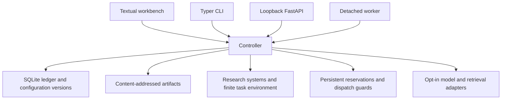

# Architecture

DOXA is a local-first, terminal-first modular monolith. The Textual workbench, Typer
CLI and optional loopback FastAPI service use the same deterministic controller and
one authoritative SQLite ledger per workspace. Detached workers are additional local
processes using that same workspace, not independent research engines.

## Modules

| Location | Responsibility |
| --- | --- |
| `src/doxa/core/` | Contracts, validated commands, scheduling, context, authorization and orchestration. |
| `src/doxa/storage/` | SQLite, additive migrations, artifacts, backups, integrity and worker ownership. |
| `src/doxa/systems/` | Research projections and deterministic transition rules. |
| `src/doxa/providers/` | Registered inference transports, request/response parsing and discovery boundaries. |
| `src/doxa/retrieval/` | Source extraction, local indexes and optional Moss integration. |
| `src/doxa/environments/` | Finite cache-policy task, independent verifier and disabled generated-code sandbox. |
| `src/doxa/cli/`, `src/doxa/api/` | Clients of controller operations, not alternate business logic. |
| `src/doxa/evaluation/`, `src/doxa/annotation/` | Explicit evaluation and annotation contracts. |

## Identity and history

Experiments pin task, Council, model, instruction and resource configurations. A run is
an attempt; a trajectory is a branch. Templates and model profiles have immutable
versions, and run participants have their own identities. Multiple participants can
share a role, model or credential without becoming independent sources of evidence.

Typed events contain scoped immutable records, causal links, provenance and per-trajectory
sequences. Revisions append versions rather than replacing claims. Forks inherit only
the ancestor prefix pinned by their checkpoint. Human annotations, model judgments,
imported sources and independent verification remain distinguishable.

SQLite transactions serialize sequence allocation and commit related events/records
atomically. Stable idempotency keys and request fingerprints reject conflicting retries.
Immutable-history triggers protect application writes; they do not provide tamper
resistance against an operator controlling the database or filesystem.

Artifacts use content-addressed SHA-256 paths and verified reads. Migrations retain
historical records. Integrity checks reconstruct indexed records from event payloads;
backups and restoration verify history and artifact hashes without merging workspaces.
See [storage](workspaces.md) and [recovery](workspaces.md#recovery-principles).

## Execution and model boundaries

Council protocols schedule bounded sequential or parallel turns. The controller applies
agent visibility, evidence and memory eligibility before assembling persisted contexts.
Call, concurrency, round, timeout, token-admission and spending limits remain explicit.
Conservative UTF-8 context bounds are not measured tokenizer usage; unknown usage or
billing remains null.

The provider registry accepts arbitrary model IDs through compatible trusted adapters.
Native transports and OpenAI-compatible endpoints are documented in
[provider support](providers.md). Registration, saving a profile and local
readiness inspection do not establish that a connection works. Paid inference and
external disclosure require separate authorization and durable admission before dispatch.
Uncertain external requests are not automatically replayed or refunded.

Account CLIs use a distinct `cli_session` profile transport, existing provider contracts
and the same controller. A trusted executable adapter runs without a shell in an empty
temporary working directory; session references remain local. Subscription-quota admission
is transactional in the canonical ledger, separate from dollar reservations; unknown
consumption/cost stays null. See [CLI providers](providers.md#configure-codex-in-the-terminal) for controls and limits.

## Evidence and tools

Source bytes, extracted text and context manifests have separate provenance and hashes.
PDF/DOCX extraction runs in a credential-filtered bounded subprocess. Local FTS5 indexes
and Moss snapshots are derived caches: the controller and Memory Tribunal still decide
eligibility. Research documents and agent memories have distinct trust rules.

Web access requires run and participant permissions, explicit disclosure authorization,
quotas and an approved domain. Live fetches additionally require the runtime switch;
public DNS pinning, TLS validation, deadlines and response bounds remain enforced.
Retrieved text is untrusted research data, never executable terminal markup or authority
to change permissions. Live search has no configured production adapter.

The independent verifier is outside the LLM Council. Objective cache-policy checks do
not make open-ended research conclusions objectively correct. The six research systems
have finite exercised behaviors; see [research systems](research-systems.md).

## Operational limits

Closing a viewer does not cancel its detached worker. Committed events support resumable
inspection; worker ownership uses OS locks. Recovery retains ambiguous calls and held
reservations until explicit reconciliation with evidence.

The API binds to loopback and retains request validation. Credentials are resolved only
in the backend through environment references or Windows DPAPI. No secrets or private
workspaces belong in builds, exports or version control. Generated-code execution stays
disabled until an enforced isolated runner and quotas exist. Studio and native desktop
clients are retired from the published tree.

## Investigation protocol

The existing controller/ledger now supports an opt-in, sequential `investigation` task
protocol alongside legacy fixed rounds. Ledger-derived claim threads feed targeted
criticism, author responses/revisions, reassessments and attributed Archivist judgments.
`ResearchOutcome` separates stopped/failed/incomplete execution from an epistemic result;
LLM-supported/rejected conclusions remain unverified model judgments. No second history,
SQL migration or six-system replacement is introduced.

Context planning and CLI validation share request serialization, schema cost and output
reservation. Required active exchanges precede bounded relevant permitted evidence; omitted
material is recorded. Full-cycle preflight executes synthetic stress in an isolated workspace,
not a live probe. Safe CLI milestones are persisted separately from validated final research
operations; private reasoning bodies are not exposed.

See the [workbench](workbench.md#investigations-and-outcomes) for protocol controls and
procedure manifests, [development](development.md#select-the-source-runtime) for source
launching, and [status](status.md) for observed verification and remaining limits.

## Design provenance

These references identify the original DOXA design material consulted during development.
They are design inputs, not evidence that a feature is implemented or scientifically validated.
Current behavior and limitations are documented in [architecture](architecture.md) and
[status](status.md). Historical handoff reports are in the [development archive](archive/README.md).
These links are provenance, not refreshed specifications or a prerequisite for installation.

| Design reference | Subject |
| --- | --- |
| [Original design lock](https://app.notion.com/p/3fd03b8af6fc81829c27df96c35f392c) | Initial research invariants and release ambitions. |
| [Research and Build HQ](https://app.notion.com/p/3f103b8af6fc819f8359c331aedc8465) | Project identity and goals. |
| [System architecture](https://app.notion.com/p/3f103b8af6fc816db112d46752ccd016) | Shared controller and module boundaries. |
| [Events and entities](https://app.notion.com/p/3f103b8af6fc81b6ac43f8758dfeaaeb) | History, identities and provenance. |
| [Agent Council](https://app.notion.com/p/3f103b8af6fc817db1c3c81b41bb2e55) | Roles and protocols. |
| [Provider strategy](https://app.notion.com/p/3f103b8af6fc8122a704cd362983deac) | Model/runtime separation and capabilities. |
| [Repository plan](https://app.notion.com/p/3f103b8af6fc81aeb6dfe844bb02b1c5) | Original stack and organization. |
| [Epistemic Git](https://app.notion.com/p/3f103b8af6fc81cc9fcff32cab2b6eba) | Claims and immutable revisions. |
| [Counterfactual Engine](https://app.notion.com/p/3f103b8af6fc8180b6c1fff62e6d66c5) | Branches and checkpoints. |
| [False Critic](https://app.notion.com/p/3f103b8af6fc81cb8490c3e66b2454aa) | Criticism and correction. |
| [Memory Tribunal](https://app.notion.com/p/3f103b8af6fc813dbb24d50a13717f77) | Memory eligibility. |
| [Self-Correction Gym](https://app.notion.com/p/3f103b8af6fc8109a6c6e778c8da6187) | Trajectory evaluation and annotation. |
| [Adaptive Reflection](https://app.notion.com/p/3f103b8af6fc81d990c5efdebd493041) | Bounded intervention policy. |
