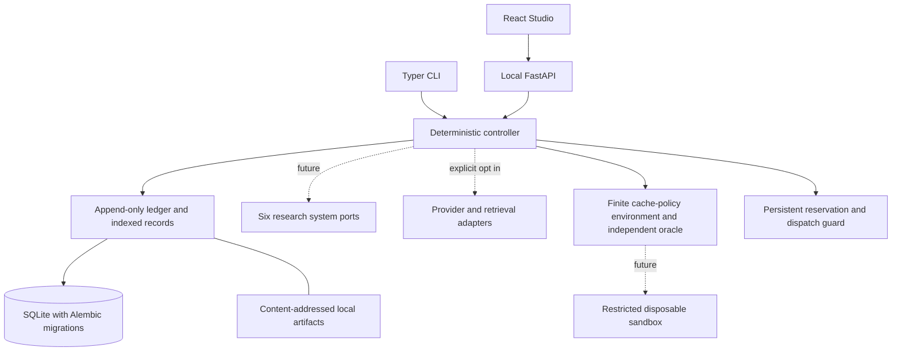

Research stage addendum: [research-systems.md](research-systems.md) documents the
controller command dispatcher, pure branch/rule projections, atomic multi-event
writes, manifested restores and annotations now implemented. Its precise scope
supersedes historical future-work statements below. No second database exists.

# Modular monolith architecture

October 24 implementation notes: [backend-stage guide](backend-stage.md) describes the
bounded runtime now implemented atop these contracts. Existing foundation data remains
readable; additive migration 0002 adds configuration history and operation metadata.

DOXA is a modular monolith. One Python process owns application orchestration and one
local SQLite database owns experimental history. Model and task adapters are ports;
the Studio does not receive provider credentials or execute tools.

Configuration performs no spending. Optional paid commands reserve and admit dispatch
before calling an external service; no paid operation was performed during the research-system implementation. An earlier
separately authorized Moss JavaScript lookup timed out; its bill remains unknown.
Artifacts are a separate working storage primitive; the ledger carries their references.

## Dependency rules

`core.models` is the shared vocabulary and has no storage/provider/UI dependency.
Ports depend on these contracts. Storage implements persistence over these contracts.
The controller composes repositories and eventually system/adapter implementations.
API and CLI call the controller; Studio calls HTTP. No service split, event broker,
background queue, hosted backend, training framework, or hidden subsystem database.
Configuration and dependency composition are explicit; imports do not create databases.

## Identity and record semantics

An Experiment is a versioned task/policy/model/budget configuration. A Run is one
configured attempt under one of four protocols. A Trajectory is a branch within a Run.
The explicit Experiment/Run split refines the design lock's shorthand “experiment/run”
so comparative attempts can share immutable experimental configuration. Root branches
have no ancestry; children pin a parent and fork event or checkpoint.

Every domain record has a UUID and schema version. Claims, memories and decisions are
immutable versions; future state changes must create new records and events rather
than update old rows. `revises_id` links claim/memory versions. Status fields describe
that version, not an in-place mutable aggregate. Run inspection projects lifecycle status
from validated RunState events; memory retrieval resolves latest immutable versions.

Events have canonical uppercase enum names, UTC timestamps, stable IDs, experiment/run/
trajectory scope, server-allocated per-trajectory sequence, causal parents, actor role,
model assignment, provenance, artifact references, typed record payload, and a unique
idempotency key. `payload` is a discriminated record union, never arbitrary provider JSON.

The original draft uppercase names remain canonical. The design lock's conceptual
“fork” maps to BRANCH_CREATED, “restore” to CHECKPOINT_RESTORED, “revision” to
CLAIM_REVISED, “verification” to VERIFICATION_RECORDED, and “run close” to RUN_CLOSED.
Added RUN_CREATED distinguishes configuration from EXPERIMENT_STARTED; added
REFLECTION_SKIPPED, ADJUDICATION_RECORDED and PROVIDER_FAILED capture missing semantics.
No second event naming scheme is emitted. These are contract vocabulary, not implemented handlers.

## Atomicity, idempotency and recovery

Alembic revision 0001 creates events, immutable indexed record versions, and reservation
tables. SQLite triggers reject UPDATE and DELETE of history. BEGIN IMMEDIATE serializes
sequence allocation and writes the event and linked records in one transaction. A failed
record insert rolls back the event. Deduplication keys return an existing semantically
identical event; changed content is rejected. Timestamps/allocated event IDs/sequences
do not change command identity. No arbitrary event-write endpoint is exposed.

The record index stores event-owned snapshots and can be reconstructed conceptually
from event payloads; a rebuild command is deferred. Foreign keys and repository checks
enforce primary event scope, ancestry and existing causal-parent membership. Typed
claim/evidence/verification/memory references, promotion gates, supersession, terminal
revocation and run transitions are checked inside the write transaction. Broader
domain transition families remain future work. Ledger is an internal repository.

SQLite file integrity is a local application guarantee, not tamper resistance against
someone who can replace the database or drop its triggers. Downgrades that erase history
fail explicitly. Future forward migrations must preserve and test old event deserialization.

Artifacts use SHA-256 paths relative to an artifact root, durable temporary writes and
atomic replacement; reads check path containment, content hash and size. The application
must not permit untrusted users to write filesystem entries in that root. No garbage
collector, checkpoint restoration, backup tool, or full export archive is implemented.

## Council and protocol boundary

Stable agents have role, instructions/versioned assignment, permissions, accepted
message contracts, and private/shared memory scope. Orchestration remains deterministic
software. Council messages carry sender, target, visibility, linked IDs and run scope.
Proposer/Defender/Adjudicator are future protocol phases, not extra primary Council roles.

Solo Direct, Solo Deliberative, Collaborative Multi-agent and Adversarial Multi-agent
have distinct bounded cache-policy flows in `core/execution.py`. They preserve the same
enum and event contracts. The legacy execution request without a typed task remains
HTTP 501. Synthetic answers are labeled imported fixture data, never real model output.
Live Solo Direct has mocked HTTP integration coverage; actual external calls remain
separately authorized and untested. Participant reads allow only eligible memory and
authorized Council messages. This is scoped context, not an authentication system; the
loopback inspector/export is the trusted local operator's complete history view.

## Research-system ports

| System | Input → output | Dependencies and responsibility |
| --- | --- | --- |
| Epistemic Git | Context + claims / checkpoint pair → claim versions / diff | Claim/evidence records; immutable commitments and inspectable revisions. |
| Counterfactual Engine | Context + checkpoint + declared intervention → child trajectory | Environment restore, verified manifests, budget guard; never rewrite parent. |
| False Critic | Context + targeted challenge → typed verification | Independent verifier and evidence; no model consensus as validity. Controller authorizes revisions. |
| Memory Tribunal | Candidate / validated transition / scope query → versioned memory / eligible set | Provenance, validation, source episode, private/shared scope, revocation; quarantine by default. |
| Self-Correction Gym | Context + baseline run → evaluation | Versioned tasks, evaluator, resource accounting, lineage; retain failures and denominators. |
| Adaptive Reflection | Context + trigger event → reason-coded decision | Observable evidence and policy/budget state; at most two interventions per branch. |

All ports share SystemContext and common domain types. Bounded operations now live in
the controller/runtime, comparison module, cache-policy environment and memory system.
General implementations of every port method remain future work. Human annotations
and preferences retain distinct contracts and provenance, separate from Gym correctness.

## Adapter and execution boundary

ModelProvider declares capabilities, typed request/response, cancellation and safe
errors. Capability values default to unknown. Configurations reserve OpenAI, Gemini,
OpenAI-compatible endpoints, and optional Claude without selecting models or prices.
Adapters must validate structured output, preserve exact IDs/settings, opt into
remote disclosure, resolve credentials locally, enforce timeout/call/context/retry limits,
reserve known worst-case cost, record usage/errors, and bound retries. The optional
RunPod implementation uses the OpenAI-compatible protocol; mocked tests cover its HTTP
boundary. Moss is a separate optional retrieval adapter; its index cannot authorize
memory. Other hosted providers still have contracts only.

TaskEnvironment defines initialize, observe, act, snapshot, restore and terminate.
The finite cache-policy prototype has a narrower concrete API with snapshots/restore
and an independent oracle; it does not pretend to implement arbitrary tool execution.
IndependentVerifier is a separate port; model criticism cannot impersonate it.
SandboxLimits describes no-network, read-only-root, CPU/memory/time/write-space limits.
DisabledSandbox is the only implementation. A future container runner must enforce
these limits and strip credentials; filesystem copies or Git worktrees alone do not
provide isolation. No generated task code runs on the host.

## Persistence and API evolution

Pydantic contracts generate domain JSON Schema and HTTP OpenAPI. Studio types are
generated from OpenAPI. Future incompatible payloads need versioned readers and a
migration/compatibility strategy; never reinterpret historical facts silently.
The HTTP surface now includes versioned configuration, bounded execution/cancellation,
memory commands/query, comparisons and accounting alongside run inspection/export.
General standalone fork and annotation mutation endpoints remain deferred.
